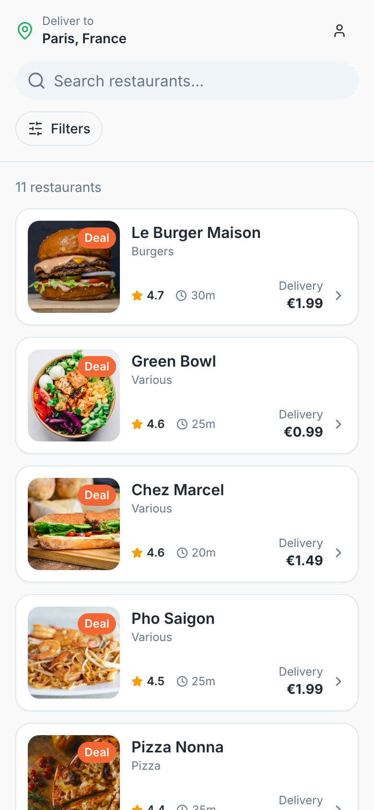
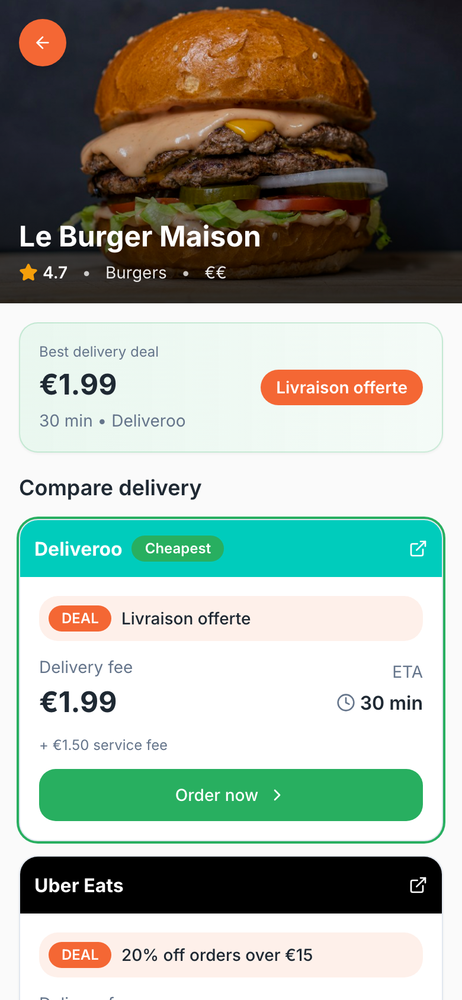
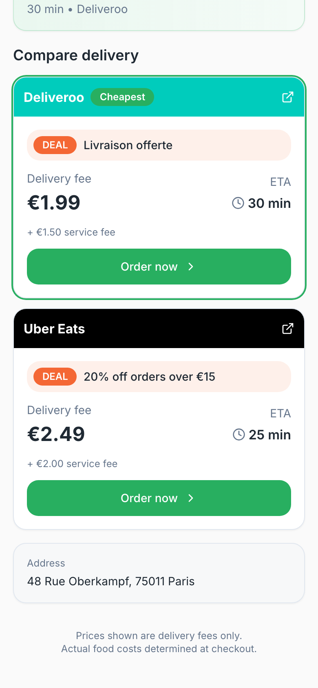
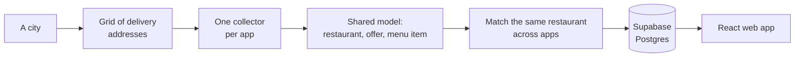

# SavvyBite

**Which delivery app should you order from?** The same restaurant is often on Uber Eats, Deliveroo and Just Eat at once, with different delivery fees, service fees, delivery times and deals. SavvyBite finds the restaurant on each app and puts them side by side.

  
  &nbsp;
  
  &nbsp;
  

The real app, shown with made-up restaurants.

*Showcase repo. The source is private. I built SavvyBite in November and December 2025 as a prototype.*

## What it does

- **One list, every app.** Restaurants near your address, each matched across the apps it is on, sorted by distance.
- **A side-by-side comparison.** For each restaurant: every app’s delivery fee, service fee, delivery time and current deal, with the cheapest marked and a button that opens that app.
- **Deals in one place.** Deals on specific dishes show the menu items they cover.
- **Installable.** A mobile-first web app that can be added to the home screen.

In its last dataset it covered 1,689 restaurants in Paris, 361 of them matched on both Uber Eats and Deliveroo.

## How it works

- **Coverage.** Delivery apps only show the restaurants that deliver to a given address. So the pipeline lays a grid of points over a city, turns each point into a street address, and searches from each one.
- **One model for every app.** Each app’s collector sits behind the same interface and outputs the same records (restaurant, offer, menu item), so adding an app doesn’t touch the rest of the pipeline.
- **Matching.** Names are normalised (accents, ® symbols, filler words such as “restaurant”), then scored with a blend of fuzzy string measures. Each restaurant keeps at most one listing per app.
- **Storage and runs.** Results go to Supabase (Postgres) through an import function. The pipeline ran twice a day on a schedule, and is packaged in Docker for cloud runs.

## Where the data came from

The prototype read listings from the delivery apps’ websites. Their terms don’t allow automated collection, so I’ve switched it off, and the source stays private. A real version would need licensed data, such as an aggregator’s API or the platforms’ own partner programmes. SavvyBite isn’t affiliated with any delivery platform.

## What I’d do differently

- **Match on location as well as name.** A chain has a “Pizza Nonna” in every district, and matching on the name alone can merge two branches into one restaurant. Comparing only listings within a few hundred metres, or sharing a postcode, fixes that.
- **Price the whole order, not just the delivery fee.** The app shows each deal next to the fees, but the comparison ranks apps on delivery fee alone. A “free delivery” or “20% off over €15” deal can change which app is cheapest, so the deal belongs in the total. Deals whose value depends on the basket, such as “buy one, get one free”, should stay out of it.
- **Licensed data from day one**, as above.

## Stack

| | |
|---|---|
| Data pipeline | Python, Pydantic, rapidfuzz, Docker, scheduled GitHub Actions runs |
| Backend | Supabase: Postgres, plus an Edge Function (TypeScript) for imports |
| Web app | React, TypeScript, Vite, Tailwind CSS, shadcn/ui, installable as a PWA; first version built in Lovable |
